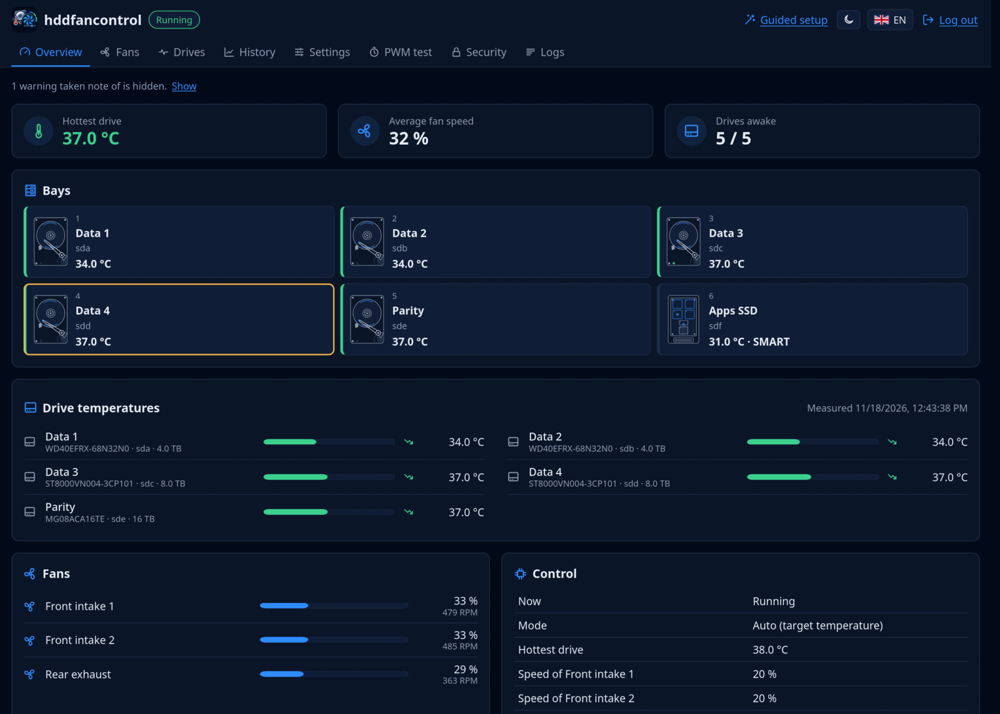
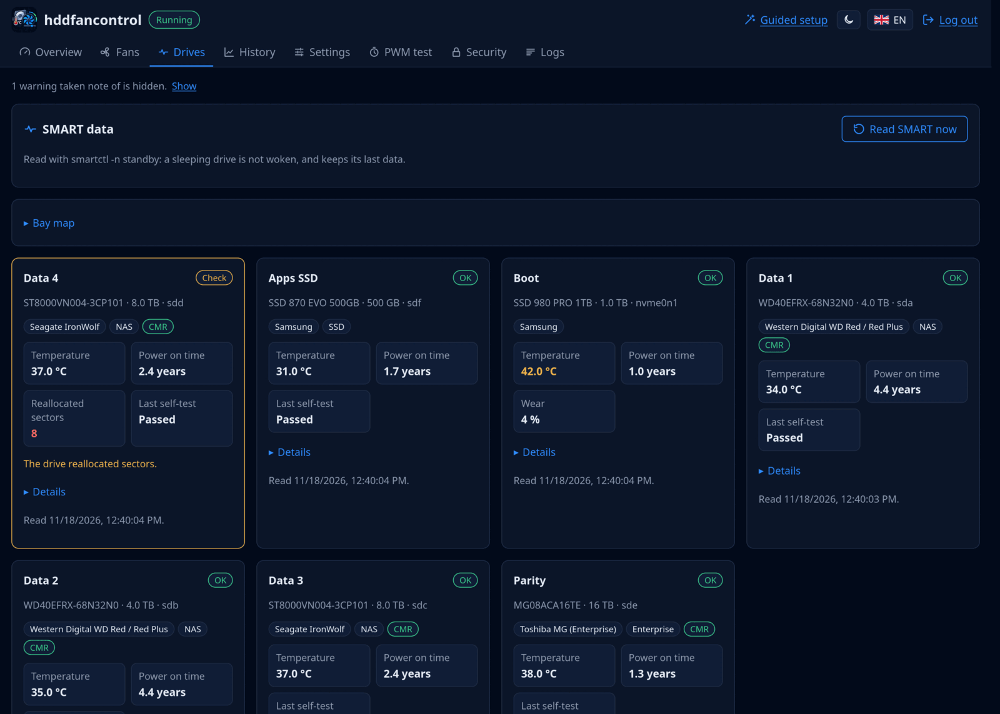
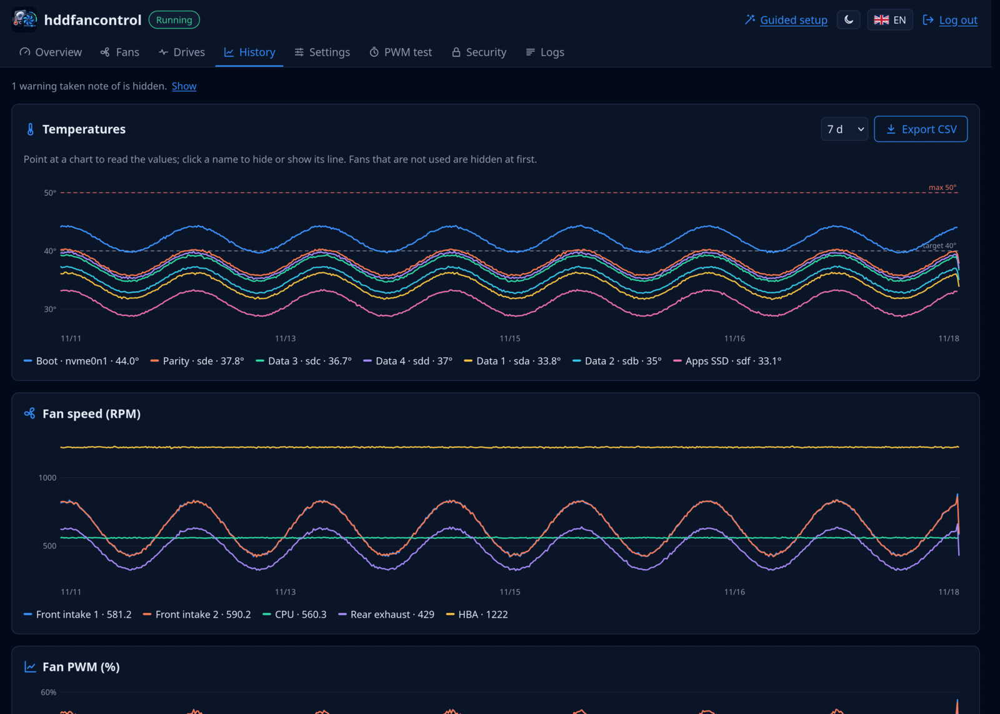
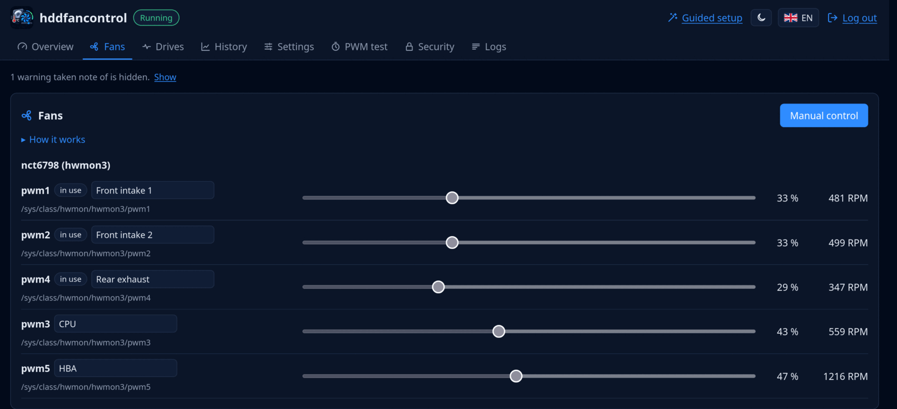
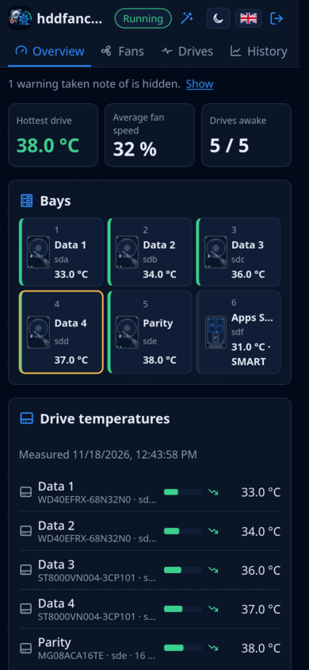

<p align="center"></p>

# hddfancontrol web UI

[](https://github.com/anto294/hddfancontrol_webui/releases)
[](https://github.com/anto294/hddfancontrol_webui/actions/workflows/ci.yml)
[](https://github.com/anto294/hddfancontrol_webui/pkgs/container/hddfancontrol_webui)
[](https://github.com/anto294/hddfancontrol_webui/releases)
[](https://github.com/anto294/hddfancontrol_webui/pkgs/container/hddfancontrol_webui)
[](LICENSE)

Control the case fans of a NAS or a home server from the temperature of its hard drives, and spin the drives down when they are idle, from a web page. Built around [hddfancontrol](https://github.com/desbma/hddfancontrol) by desbma and [hd-idle](https://github.com/adelolmo/hd-idle) by adelolmo, for **any Linux system**: TrueNAS SCALE, Proxmox VE, Unraid, OpenMediaVault, Debian, Ubuntu, Fedora, Arch… As a Docker image or as a systemd service, on x86_64 and arm64.

> [!NOTE]
> The drive temperatures come from [hddfancontrol](https://github.com/desbma/hddfancontrol) by desbma, which measures the drives without waking them. This project runs it and hd-idle, keeps them running, drives the fans from what it measures (curve and auto modes, fan groups, limits per drive), and adds the web UI, manual control, the history, SMART data and alerts. It is not an official desbma project.

<p align="center"></p>

## Quick start

With Docker Compose (for TrueNAS SCALE, Proxmox VE and the others, see [Installation](#installation)):

```bash
mkdir hddfancontrol && cd hddfancontrol
curl -fsSLO https://raw.githubusercontent.com/anto294/hddfancontrol_webui/main/docker-compose.yml
docker compose up -d
docker compose logs | grep 'FIRST SETUP'
```

Open `https://<host>:28462` (the certificate is self-signed: accept it once), type the setup code from the last command, choose a username and a password, and follow the guided setup.

## Contents

- [Quick start](#quick-start)
- [What you can do with it](#what-you-can-do-with-it)
- [Requirements](#requirements)
  - [Tested hardware](#tested-hardware)
- [Installation](#installation)
- [First setup](#first-setup)
- [Fan control modes](#fan-control-modes)
  - [Safety rules](#safety-rules)
- [Spin down](#spin-down)
- [History, SMART data and names](#history-smart-data-and-names)
- [On a phone](#on-a-phone)
- [Prometheus and Grafana](#prometheus-and-grafana)
- [Alerts](#alerts)
  - [Schedules](#schedules)
- [Security](#security)
  - [HTTPS](#https)
- [Environment variables](#environment-variables)
- [Resource use](#resource-use)
- [Troubleshooting](#troubleshooting)
- [How it works](#how-it-works)
- [Contributing](#contributing)
- [Credits and license](#credits-and-license)

## What you can do with it

- **Quiet fans, cool drives.** The fans follow the hottest drive, along a curve or in the auto mode, which keeps the drives at a target temperature with as little fan speed as it can. Each fan can follow its own drives, and each drive can have its own limits.
- **Safety first.** A drive at its maximum, temperatures that stop coming in, or an error of the fan control put the fans at full speed. When the web UI stops, every fan gets its previous setting back.
- **Easy setup.** A guided setup asks one question at a time. Manual control and an **Identify** button show which fan is which, and the PWM test finds the speed at which each fan starts and stops.
- **Watch the drives.** SMART health, scheduled self-tests, what each drive is (NAS or desktop, CMR or SMR, how it is connected), and a map of the bays of the case with the drives in them.
- **Know when something is wrong.** A hot drive, a stopped or worn fan, a SMART problem: a banner, a log line and, if you want, a message on your phone through ntfy, Gotify or a webhook.

Also: spin down of idle drives with hd-idle (nothing in the web UI wakes a sleeping drive), history charts from one hour to a year, names for fans and drives, settings backup, Prometheus metrics, a light and a dark theme, a phone layout, and seven languages (English, Italian, Spanish, French, Chinese, Hindi, Arabic).

<table>
  <tr>
    <td></td>
    <td></td>
  </tr>
  <tr>
    <td></td>
    <td align="center"></td>
  </tr>
</table>

## Requirements

- A mainboard whose fan headers are PWM-controlled through a Linux hwmon driver (`nct6775`, `it87`, …). Most consumer and many server boards work; if a BIOS fan mode exists, the fans must not be locked at full speed.
- **Linux on the machine that has the fans and the drives**, x86_64 or arm64. The web UI must run on that host (or in a privileged container on it): a virtual machine does not see the fan chip, and an unprivileged LXC container cannot write it.
- **Docker:** any host with Docker. TrueNAS SCALE 24.10 or later runs it as a Custom App, Unraid as a container.
- **Bare metal:** Linux with systemd and Python 3.11 or later (Debian 12, Ubuntu 24.04, Proxmox VE 8, OpenMediaVault 7, Fedora, Arch, …), plus `smartmontools` and `hdparm`.

### Tested hardware

| Fan chip (module) | Mainboard | System | Result |
|---|---|---|---|
| nct6798 (`nct6775`) | ASRock B550M PG Riptide | TrueNAS SCALE, Docker | Works |

Tried it on other hardware? Please send a [hardware report](https://github.com/anto294/hddfancontrol_webui/issues/new?template=hardware_report.yml), whether it works or not. Your fans, sensors or server are not supported? Open a [hardware support request](https://github.com/anto294/hddfancontrol_webui/issues/new?template=hardware_support.yml): it guides you through what to send.

## Installation

| System | How |
|---|---|
| TrueNAS SCALE | [Custom App](#truenas-scale) (Docker): TrueNAS does not let you install packages on the host |
| Proxmox VE | [Bare metal](#bare-metal) on the Proxmox host, or [Docker](#docker-compose) installed on the host. Not in a VM, nor in an unprivileged LXC container |
| Unraid | [Docker](#docker-compose): a container with **Privileged** on, `/config` on `appdata` |
| OpenMediaVault | [Docker](#docker-compose) (the compose plugin) or [bare metal](#bare-metal) |
| Debian, Ubuntu, Fedora, Arch, … | [Bare metal](#bare-metal) or [Docker](#docker-compose) |

### TrueNAS SCALE

1. Create a dataset for the settings, for example `apps/hddfancontrol`.
2. Go to **Apps → Discover Apps → ⋮ → Install via YAML**, name the app `hddfancontrol`, and paste [docker-compose.yml](docker-compose.yml) with the `./config` volume changed to your dataset (`/mnt/tank/apps/hddfancontrol:/config`).
3. Open `https://<truenas>:28462` and accept the self-signed certificate. The first visit asks for the **setup code**, which is in the logs of the app (**Apps → hddfancontrol → Logs**, the line with `FIRST SETUP`), then for a username and a password.

Keep the `stop_grace_period: 60s` of the example. When the app stops, the web UI first gives the fans back to the chip, then stops the daemons and its web server, and that can take longer than Docker's default of 10 seconds. If your app was installed from an older YAML without it, go to **Apps → hddfancontrol → Edit**, add the line under `init: false`, and save.

If the web UI says it cannot load a kernel module (for example `nct6775`), TrueNAS has the module but the container cannot load it. Load it on the host once:

1. **System → Advanced Settings → Init/Shutdown Scripts → Add**
2. Type **Command**, Command `modprobe nct6775`, When **Post Init**, then **Save**.
3. Run `sudo modprobe nct6775` once in **System → Shell** (or reboot), and press **Scan again** in the web UI.

### Docker Compose

```bash
mkdir hddfancontrol && cd hddfancontrol
curl -fsSLO https://raw.githubusercontent.com/anto294/hddfancontrol_webui/main/docker-compose.yml
docker compose up -d
docker compose logs | grep 'FIRST SETUP'   # the setup code the first visit asks for
```

The image is `ghcr.io/anto294/hddfancontrol_webui`, with these tags:

| Tag | What it is |
|---|---|
| `latest` | The latest stable release. **Use this one** |
| `X.Y` | The latest release of a minor version, with its fixes (`0.10` follows `v0.10.1`, `v0.10.2`…) |
| `vX.Y.Z` | One release, never moved: to pin a version |
| `edge` | The `main` branch, built at every change: the next release before it is out |
| `experimental` | The [`experimental`](https://github.com/anto294/hddfancontrol_webui/tree/experimental) branch, `edge` plus hardware under test (such as server fans through a BMC). Checked like `main`, but for testers, not for everyday use |

Every image is built for `linux/amd64` and `linux/arm64`, with a provenance attestation (how and from which commit it was built) and its list of packages (SBOM). The version shows at the bottom of the web UI (`edge-<commit>` and `experimental-<commit>` for the branches).

The container runs privileged, because it writes the PWM files of `/sys` and sends ATA commands to the drives. Without `privileged`, Docker mounts `/sys` read only: the web UI then shows a warning, works read only, and starts neither hddfancontrol nor hd-idle. The root file system can be read only, since everything the app keeps is in `/config`.

### Bare metal

Download `hddfancontrol-webui-<version>-linux-<arch>.tar.gz` from the [latest release](https://github.com/anto294/hddfancontrol_webui/releases/latest) (`amd64` or `arm64`), then:

```bash
tar xzf hddfancontrol-webui-*-linux-amd64.tar.gz
cd hddfancontrol-webui-*-linux-amd64
sudo ./install.sh
```

To check first that the tarball was built by this repository's release workflow from the tagged source (with the [GitHub CLI](https://cli.github.com/)):

```bash
gh attestation verify hddfancontrol-webui-*-linux-amd64.tar.gz --repo anto294/hddfancontrol_webui
```

The tarball carries static builds of hddfancontrol 2, hd-idle and sdparm, so the version of your distribution does not matter (Debian still ships hddfancontrol 1, whose options differ), and the Python packages it needs (aiohttp and its dependencies, checked against their hashes): the install downloads nothing. `install.sh` puts everything in `/opt/hddfancontrol-webui`, the settings in `/etc/hddfancontrol-webui/env`, the data in `/var/lib/hddfancontrol-webui`, and starts the `hddfancontrol-webui` service. Run it again from a newer tarball to update.

- Logs: `journalctl -u hddfancontrol-webui`
- Remove, keeping settings, history and the `hddfancontrol-webui` user that owns the login data: `sudo ./install.sh --uninstall`
- Remove everything, the user too: `sudo ./install.sh --purge`

On bare metal, `sensors-detect --auto` does not run at start, because on a real host it can change `/etc/modules`. Run `sudo sensors-detect` once instead, or set `LOAD_SENSOR_MODULES=true` in `/etc/hddfancontrol-webui/env`.

## First setup

On the first start, with no drive and no fan chosen, the web UI opens the **guided setup**: follow it and you are done. You can open it again from the header at any time. To set things up by hand instead:

1. **Security:** the first visit asks for the setup code of the container's log and creates the username and password (or set `WEBUI_USERNAME` and `WEBUI_PASSWORD`). Change them later in the **Security** tab.
2. **Fans:** check that the **Fans** tab lists your fan chip and its PWM outputs. If it does not, see [Troubleshooting](#troubleshooting).
3. **PWM test:** in **PWM test**, tick the outputs with a fan and start the test. Each fan stops and starts several times, for a few minutes per fan; then **Use these values in the settings** copies what the test found. The drives stay safe meanwhile: if one reaches its maximum, or the temperatures stop coming in, the test stops and the fans go back under control. The test of one fan never lasts more than 10 minutes.
4. **Settings:** tick the drives and the fans, choose a mode and its temperatures, and **Save and apply**.

## Fan control modes

| Mode | What drives the fans | You set |
|---|---|---|
| **Curve** | The web UI: minimum speed up to the minimum temperature, full speed from the maximum, in proportion in between | Minimum and maximum temperature, minimum speed |
| **Auto** | The web UI keeps the hottest drive near a target with as little speed as it needs, and adapts to load, season and case by itself | Target and maximum temperature, minimum speed |
| **Manual** | You, with a slider per PWM output, until you go back or the container restarts | — |

In every mode hddfancontrol only measures: it reads the drive temperatures without waking sleeping drives, and the web UI writes the PWM files.

- **Curve:** the same curve as hddfancontrol, with a margin so that the fans do not keep speeding up and slowing down: a drive asks for more speed as soon as it warms, but for less only once it is 2 °C cooler, and a fan slows down by at most 10 % per check. **Average** (`AVERAGE`) averages the last samples of each drive first.
- **Auto:** a PI controller (feedback control, not machine learning). It speeds up at once when the drives warm, and slows down at most 10 % per check, so a short dip does not stop the fans.
- **Fan groups:** in **Settings**, each fan can follow only some drives; by default it follows all of them. A fan whose drives are all gone from the host follows every drive.
- **Limits per drive:** each drive can have its own minimum, target and maximum instead of the common ones. The **Drives** tab shows the highest temperature the drive itself recommends. It is only a hint and is never applied by itself: some drives, such as the Seagate Exos, report 40 °C, well under the limit of their datasheet.
- **Extra sensors:** the temperature sensors of **Settings** count when they have a range: each asks for a speed in proportion between its minimum and maximum, and every fan runs at the higher of that and what its drives need.

### Safety rules

These hold in every mode, whatever the settings:

- **A hot drive** puts its fans at full speed: at its maximum temperature, or at 65 °C (80 °C for an NVMe drive) even when its maximum is set higher. In manual control it puts every fan at full speed, until you leave manual control.
- **Limits are capped.** Drive temperatures in the settings go up to 80 °C, and the limits of one drive up to 70 °C unless it is NVMe.
- **No temperatures, full speed.** Temperatures that stop coming in, or hddfancontrol stopping, put every fan at full speed. In manual control this applies only when drives are chosen, so that you can find out which fan is which before choosing them.
- **A missing reading is held.** A drive whose temperature turns empty (asleep, or a failed probe during heavy I/O) keeps its last temperature for five checks.
- **The fans go back.** When control ends, every PWM output gets its previous mode back, or stays at full speed with `RESTORE_FAN_SETTINGS=false`.

## Spin down

hd-idle spins the chosen drives down after an idle time. One time applies to every drive, and the drive list of **Settings** can set another per drive, where 0 keeps that drive spinning. Drives that are not chosen are never spun down. Use `scsi` as the command type for SAS drives and for USB enclosures that do not pass ATA commands.

## History, SMART data and names

- **History:** every 30 seconds the web UI stores the drive temperatures that hddfancontrol measured (each drive under its `/dev/disk/by-id` name, since `sda` can be another drive after a reboot), and the PWM and speed of every fan, in `/config/history.db` (SQLite). It keeps 30 days by default; longer windows are averaged, so a chart never has more than 600 points per line.
- **Logs:** besides the lines of hddfancontrol, hd-idle and the web UI, `docker logs` and the **Log** tab show a `[temps]` line: the drives the fans follow (and the hottest one), the chosen fans with their PWM and speed, and the drives that are only monitored, with their last SMART temperature. The line is written when a value changes by a degree or a percent, and at least every 10 minutes.
- **SMART:** `smartctl -a -n standby` reads the drives marked as monitored in **Settings** (by default, the drives the fans follow) every 6 hours by default, and when you press **Read SMART now**. A drive that is asleep is not woken and keeps its last data.
- **SMART self-tests:** set **Short/Long SMART self-test** in **Settings → Schedules** (cron expressions, such as `0 3 * * sun`) and the web UI starts the tests on every monitored drive. It never starts one on a sleeping drive (it tries again for 3 hours), runs the long test first, and starts no other test on that drive for a day. The drive runs the test by itself, and the next SMART read shows the result; a failed test is a SMART warning. TrueNAS can schedule self-tests too: use one or the other, not both.
- **Bay map:** in **Drives → Bay map**, draw the bays of the case (rows and columns as seen from the front) and put each drive in its bay. The overview then shows the drives as they sit in the case, with their temperature and any SMART problem, so you find the drive to pull at once. Each bay draws its drive at work: the platter of a hard drive turns while it spins and its head moves while it reads or writes, and an activity light follows the real I/O, taken from the kernel's counters, which never wake a drive. Kept in `/config/bays.json`.
- **Processor:** the **Control** card of the overview shows the share of busy time of the processors, the load average and the package temperature.
- **Names:** give a fan or a drive a name in the **Fans** tab or the drive list of **Settings**. Names are kept in `/config/labels.json`, and changing one does not restart fan control. Drives are named by their `/dev/disk/by-id` path, which does not change between boots.

## On a phone

The web UI fits a phone screen, and can go on its home screen as an app: in Safari on iPhone, **Share → Add to Home Screen**; in Chrome on Android, **⋮ → Add to Home screen**. It then opens full screen, without the browser bars. Chrome installs it as a real app only over HTTPS with a certificate it trusts ([HTTPS](#https) with your own certificate, or a reverse proxy); otherwise it is a shortcut that opens in the browser.

## Prometheus and Grafana

`/metrics` gives the state in the Prometheus text format: drive temperatures (and whether each drive sleeps), PWM and RPM of every fan, the speed fan control asks of each chosen fan, SMART state and warnings, alerts in force by kind, and whether the fans run at full speed for safety. It needs the username and password, as HTTP Basic credentials:

```yaml
scrape_configs:
  - job_name: hddfancontrol
    static_configs:
      - targets: ["truenas.lan:28462"]
    basic_auth:
      username: admin
      password: your-password
```

## Alerts

The web UI watches for:

- a drive the fans follow at or above its maximum temperature (the alert ends 2 °C under it);
- a chosen fan that stops: 0 RPM for 2 minutes while its PWM value is well over its stop value (only fans that were seen turning, so a connector without a speed sensor never counts);
- SMART saying that a monitored drive is failing, or reporting a problem (an attribute under its threshold only in the past is shown on the drive card, not raised);
- a monitored drive that is not on the host any more, or whose SMART data cannot be read;
- a chosen fan that turns 15 % slower than it used to at the same PWM, which is how worn bearings show before the fan stops (the baseline is the first week of the fan's history, taken once that history is two weeks old, so `HISTORY_DAYS` must be 14 or more);
- drive temperatures that stop coming in, or an error of the fan control itself, which put every fan at full speed;
- a chosen fan whose chip is not found any more (see [Troubleshooting](#troubleshooting)).

Each alert shows as a banner (**Noted, hide** hides it until it gets worse or comes back) and is logged (`[alerts]` in `docker logs`). When an address is set in **Settings → Notifications** or with `NOTIFY_URL`, the alert and its end are also sent there; **Send a test message** checks the address. The address depends on the format:

- **ntfy**: `https://ntfy.sh/a-topic-of-yours` (pick a topic nobody can guess), or your own ntfy server.
- **Gotify**: `https://your-server/message?token=APP_TOKEN`, with format `gotify`.
- **json**: any webhook that takes a POST with `{"title", "message", "level"}` (`level` is `alert` or `ok`).

Messages are never sent to the NAS itself (`localhost`, `127.0.0.1`) or to link-local addresses (`169.254.…`, `fe80::…`): for a server on the LAN, also one running on this NAS, use its LAN address (`http://192.168.1.10:2586/…`).

An alert that stays on can be sent again every few hours (**Remind every**), unless you took note of it. In the **quiet hours** only urgent alerts go out (a hot drive, fans at full speed, a failing or missing drive, missing fans); the others, and the ends of alerts, are sent together when the quiet hours end. A **summary** can come on a schedule, with the highest and average temperature of each drive, the speed of each fan, the alerts and the SMART state since the previous summary. The quiet hours and the summary are set in **Settings → Schedules**.

### Schedules

Every schedule (SMART reads, self-tests, summary, quiet hours) is a cron expression as in crontab: `minute hour day month weekday`, with `*`, ranges (`1-5`), lists (`1,15`), steps (`*/6`), names (`mon`, `jan`) and the macros `@hourly`, `@daily`, `@weekly`, `@monthly`, `@yearly`. Each field offers a few ready-made ones and shows its next runs as you type; **Compose** next to it writes the expression from a small form (how often, at what time, on which days, or from one hour to another for the quiet hours). When both the day of the month and the weekday are given, either one is enough, as in cron. For the quiet hours every minute the expression matches is quiet: `* 22-23,0-6 * * *` is every night from 22 to 7. An empty field means never. The times are those of the server: set `TZ` on the container (TrueNAS apps run in UTC otherwise).

## Security

The container runs privileged, because the fans and the drives need it, so the web UI is built to keep the network away from root. In short:

- **Two processes.** The core, which drives the fans and the drives, runs as root and listens only on a Unix socket. The web server (the gateway) runs as an unprivileged user and passes on only the requests of a logged-in user.
- **No open first start.** Creating the credentials needs a one-time code written in the container's log.
- **Private networks and names of the LAN only**, by default: other addresses and other host names get a bare 403. Behind a reverse proxy with a public domain, set `WEBUI_HOSTS`; for other networks, `WEBUI_ALLOW`.
- **Every change** needs a valid session, a header other sites cannot send and a matching origin, and goes to the audit log.

To reach the web UI from outside your network, use a VPN, or a reverse proxy with HTTPS in your LAN. The details, and how to report a vulnerability, are in [SECURITY.md](SECURITY.md).

> [!WARNING]
> The image uses Alpine's aiohttp (3.13.5 in Alpine 3.24), which several published advisories affect; they are fixed in aiohttp 3.14.4, and the image will move to it as soon as Alpine ships it. Until then, keep the port to your LAN (the default) and do not publish it to the Internet. The bare metal package already needs 3.14.4.

### HTTPS

The web UI speaks HTTPS on its own port (`ENABLE_TLS=false` turns it off). Without `TLS_CERT` and `TLS_KEY` it makes a self-signed certificate at the first start, in `/config/web/tls` (valid 10 years, for the host name, `localhost` and `127.0.0.1`): the browser warns once, and you accept it for that address. To avoid the warning, give your own certificate and key (PEM files, mounted in the container) with `TLS_CERT` and `TLS_KEY`.

The same port still answers plain HTTP, so an old bookmark keeps working; with `FORCE_HTTPS=true` a page asked over HTTP sends the browser to the same address over HTTPS, and the API and `/metrics` refuse plain HTTP (403). `/healthz` stays on HTTP for the container health check. Behind a reverse proxy that terminates HTTPS, `FORCE_HTTPS` alone does the same for the requests the proxy marks as HTTP (`X-Forwarded-Proto`). The move to HTTPS is made by the browser from its own address bar, never from the `Host` header, which a client can forge. The web UI sends no `Strict-Transport-Security`: with a self-signed certificate the browser would then refuse the page instead of warning.

If the certificate cannot be read or made, the web UI starts over plain HTTP (no redirect) and says why in the log: the fans are controlled either way. Opened over plain HTTP from another host, the login page warns that the password would cross the network in clear text, with a link to the same address over HTTPS.

## Environment variables

The variables of **Web UI and access**, the advanced ones and `TZ` are read only from the environment. The others can also be set in the web UI, which then stores them in `/config/settings.json`; from then on the file wins, and **Back to environment variables** deletes it.

### Web UI and access

| Variable | Default | Meaning |
|---|---|---|
| `WEBUI_USERNAME` | `admin` | Username, when `WEBUI_PASSWORD` is set |
| `WEBUI_PASSWORD` | — | Password of the web UI; without it, the first visit creates the credentials with the setup code of the log |
| `WEBUI_PORT` | `28462` | Port of the web UI (8080 before 0.9.0) |
| `WEBUI_HOST` | `0.0.0.0` | Address to listen on |
| `WEBUI_ALLOW` | private networks | Networks allowed to connect, as CIDRs separated by commas or spaces; `private` stands for the default networks, `all` for every address; loopback is always allowed. See [Security](#security) |
| `WEBUI_HOSTS` | names of the LAN | Host names the browser may use besides IP addresses and names of the LAN, by commas or spaces; `*.example.com` for subdomains, `any` for every name. Needed behind a reverse proxy with a public domain. See [Security](#security) |
| `ENABLE_TLS` | `true` | Serve HTTPS (and plain HTTP) on `WEBUI_PORT`; `false` serves plain HTTP only; see [HTTPS](#https) |
| `FORCE_HTTPS` | `false` | Redirect plain HTTP to HTTPS |
| `TLS_CERT`, `TLS_KEY` | — | Certificate and key (PEM) to use; without them a self-signed pair is made in `/config/web/tls`. They are copied to `/config/web-tls` at start, so the gateway can read them |

### Fan control

| Variable | Default | Meaning |
|---|---|---|
| `DRIVES` | — | Drives, separated by spaces: `/dev/disk/by-id/...` paths or interface names (`ata`) |
| `MONITOR_DRIVES` | the `/dev` paths of `DRIVES` | Drives whose SMART data is read and shown, `/dev/disk/by-id/...` paths separated by spaces; set but empty, none |
| `PWM` | — | Fans, as `PWM_PATH:START:STOP`, separated by spaces |
| `CONTROL_MODE` | `curve` | `curve` or `auto` |
| `DRIVE_TEMP_RANGE` | `30 50` | Minimum and maximum temperature, °C |
| `TARGET_TEMP` | `40` | Target temperature of the auto mode, °C |
| `MIN_FAN_SPEED_PRCT` | `20` | Minimum fan speed, % |
| `INTERVAL` | `20s` | Check interval (`10s`, `1min`, …) |
| `AVERAGE` | `1` | Number of samples of each drive to average |
| `HWMONS` | — | Other temperature inputs, as `PATH[:MIN:MAX]`, separated by spaces; give the path under `/sys/class/hwmon/` (hddfancontrol cannot read a path with `:`, such as a PCI one under `/sys/devices/`) |
| `RESTORE_FAN_SETTINGS` | `true` | When the web UI stops, give the fans back their settings; `false` leaves them at full speed (a restart after a change always gives them back) |
| `VERBOSITY` | `INFO` | Log level of hddfancontrol: `TRACE`, `DEBUG`, `INFO`, `WARN` or `ERROR` |

### Spin down

| Variable | Default | Meaning |
|---|---|---|
| `SPIN_DOWN_TIME_S` | `600` | Idle time before spin down, seconds; `0` turns hd-idle off |
| `SPIN_DOWN_COMMAND` | `ata` | `ata` or `scsi` |

### History, SMART and alerts

| Variable | Default | Meaning |
|---|---|---|
| `HISTORY_DAYS` | `30` | Days of history to keep |
| `SMART_SCHEDULE` | `0 */6 * * *` | When SMART is read (cron, see [Schedules](#schedules)); empty reads only on demand. The older `SMART_INTERVAL_H` (hours) still works |
| `SELFTEST_SHORT` | — | When a short SMART self-test starts (cron), such as `0 3 * * sun` |
| `SELFTEST_LONG` | — | When a long SMART self-test starts (cron), such as `0 3 1 * *` |
| `NOTIFY_URL` | — | Where alerts are sent (see [Alerts](#alerts)); empty, none |
| `NOTIFY_FORMAT` | `ntfy` | `ntfy`, `gotify` or `json` |
| `NOTIFY_LANGUAGE` | `en` | Language of the alerts: `en`, `it`, `es`, `fr`, `zh`, `hi` or `ar` |
| `NOTIFY_REPEAT_H` | `0` | Send again an alert still on (and not taken note of) every this many hours; `0` sends it once |
| `NOTIFY_QUIET` | — | Quiet hours, the minutes a cron expression matches, such as `* 22-23,0-6 * * *`: only urgent alerts go out, the rest when they end |
| `NOTIFY_SUMMARY` | — | When a summary is sent (cron), such as `0 9 * * mon` |
| `TZ` | — | Time zone of the container (such as `Europe/Rome`), for the schedules |

<details>
<summary><b>Advanced</b>: the user of the web server, folders, programs, access log</summary>

| Variable | Default | Meaning |
|---|---|---|
| `WEBUI_USER` | `hddfancontrol-webui` | User the gateway (the web server) runs as; when it does not exist, or is root or in root's group, the web UI does not start (an error in the log) and the fans are still controlled |
| `CONFIG_DIR` | `/config` | Where settings, names, history and credentials are kept |
| `WEBUI_ACCESS_LOG` | `false` | Log every HTTP request with the client's address, in the gateway's lines (the page polls every few seconds) |
| `LOAD_SENSOR_MODULES` | `true` (`false` bare metal) | Run `sensors-detect --auto` at start and load the chip modules it finds |
| `CHECK_UPDATES` | `true` | Ask GitHub once a day for the latest release and name a newer one in the footer of the page; nothing about the host is sent |
| `HDDFANCONTROL_BIN`, `HDIDLE_BIN`, `SMARTCTL_BIN`, `SENSORS_DETECT_BIN`, `MODPROBE_BIN` | from `PATH` | Programs to use |

</details>

## Resource use

The web UI is two Python processes with aiohttp, the core and the gateway, which use about 45 MB of memory each; a login briefly takes 16 MB more (scrypt), and hddfancontrol and hd-idle add a few MB. The compose example sets a 256 MB limit. The browser asks for data only while its tab is visible, the temperature log is read from its end only, and the history is written every 30 seconds in one transaction. The image is based on Alpine, with Python and aiohttp from Alpine's own packages.

## Troubleshooting

**The Fans tab shows no PWM output.** The kernel module of the fan chip is not loaded. The web UI names the module it found and could not load; on TrueNAS, load it on the host as shown in [Installation](#truenas-scale). If `dmesg` then shows a resource conflict with ACPI, the chip also needs the kernel option `acpi_enforce_resources=lax`; on TrueNAS SCALE, run `midclt call system.advanced.update '{"kernel_extra_options": "acpi_enforce_resources=lax"}'` in the shell and reboot.

**The log says the gateway could write `/config`.** The folder of the settings must be writable by root only, since the core trusts what it finds there. The web UI gives it to root and removes the write permission of group and others by itself (also from a folder with the sticky bit, such as mode 1777); when the host refuses (an ACL, NFS with root squash), the web UI does not start at all: the fans are still controlled, but the page is not served until the folder is fixed. Fix the permissions of the dataset (owner root, no write for others) and restart.

**A yellow banner names a problem of permissions, devices or programs.** At start the web UI checks what it needs (root, a writable `/config`, the drives in `/dev`, the fan files, the capabilities for SMART and the sensor modules, the programs) and says what to do for each one it lacks; the log has the same lines (`startup check:`). Most are fixed by `privileged: true` and the volumes of the example; restart after the fix. **Hide** hides one in that browser while it says the same.

**The web UI says it is read only.** `/sys` is mounted read only, which is what Docker does for a container that is not privileged, so no fan can be written: hddfancontrol and hd-idle do not start, and manual control and the PWM test are off. Set `privileged: true` (on TrueNAS SCALE, tick **Privileged** in the app settings) and restart the container.

**A fan does not react to its slider.** The header may be in DC mode, or the BIOS may hold it at a fixed speed. Set the header to PWM mode in the BIOS.

**Still no fan, or a server whose fans belong to its BMC (Dell iDRAC, HPE iLO).** In **Fans → Hardware not supported?**, **Prepare a support request** fills in a [hardware support request](https://github.com/anto294/hddfancontrol_webui/issues/new?template=hardware_support.yml) from the host: you see it all, then open it on GitHub, name the machine and say what you need. Or open the form yourself: it says which commands to run and what to paste. Either way, support can be added for hardware we do not own.

**The hwmon number of the fan chip changed after a reboot or a system update.** Linux numbers hwmon devices in the order they appear, so `hwmon3` can become `hwmon4`, for example after a TrueNAS update loads the modules in another order. The web UI keeps each chosen fan with its chip (`/sys/devices/platform/nct6775.656`, for example): at start it finds the chip under its new number, corrects the settings and the fan's name, and says so in the log. If the chip is not there at all (its module is not loaded, or a new kernel names it differently), those fans alone are not controlled, and never another chip's outputs in their place; a banner and an alert name them. The other fans are controlled and the drives watched meanwhile. The web UI looks for the chip again every minute and after **Scan again**, and controls those fans as soon as it is back: loading the module is enough. Otherwise, choose the fans again in **Settings**.

**A drive never sleeps.** Something reads or writes it: a pool scrub, SMART tests, an app. The web UI itself reads temperatures only through hddfancontrol, which leaves sleeping drives alone, and SMART data only with `-n standby`.

## How it works

[docs/](docs/README.md) explains the inside of the web UI and the reasons behind it: the processes and where the data lives, how the fans are driven and the safety rules, SMART and alerts, the security design, the page, and a list of every design choice with its reason.

## Contributing

Bug reports, hardware reports and pull requests are welcome: see [CONTRIBUTING.md](CONTRIBUTING.md) for the setup, the checks and the conventions. Vulnerabilities go through [SECURITY.md](SECURITY.md).

## Credits and license

- [hddfancontrol](https://github.com/desbma/hddfancontrol) by desbma (GPL-3.0) measures the drive temperatures without waking the drives.
- [hd-idle](https://github.com/adelolmo/hd-idle) by adelolmo (GPL-3.0) spins the drives down.
- [sdparm](https://sg.danny.cz/sg/sdparm.html) by Douglas Gilbert (BSD) reads the state of SAS drives.

This project is released under the [GNU General Public License v3.0](LICENSE). The image and the release tarballs include the programs above, under their own licenses.
