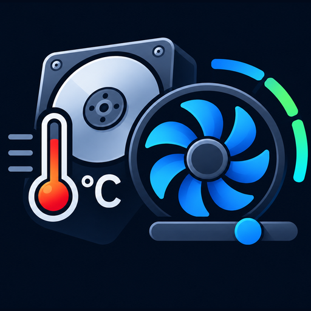

<p align="center"></p>

# hddfancontrol web UI

[](https://github.com/anto294/hddfancontrol_webui/releases)
[](https://github.com/anto294/hddfancontrol_webui/actions/workflows/ci.yml)
[](https://github.com/anto294/hddfancontrol_webui/pkgs/container/hddfancontrol_webui)
[](LICENSE)

Control the case fans of a NAS from the temperature of its hard drives, and spin the drives down when they are idle, from a web page. Built around [hddfancontrol](https://github.com/desbma/hddfancontrol) by desbma and [hd-idle](https://github.com/adelolmo/hd-idle) by adelolmo, for **TrueNAS SCALE** first, and for any Linux system with Docker or systemd.

> [!NOTE]
> The drive temperatures come from [hddfancontrol](https://github.com/desbma/hddfancontrol) by desbma, which measures the drives without waking them. This project runs it and hd-idle, keeps them running, drives the fans from what it measures (curve and auto modes, fan groups, limits per drive), and adds the web UI, manual control, the history, SMART data and alerts. It is not an official desbma project.

## Contents

- [What you can do with it](#what-you-can-do-with-it)
- [Requirements](#requirements)
- [Installation](#installation)
- [First setup](#first-setup)
- [Fan control modes](#fan-control-modes)
- [Spin down](#spin-down)
- [History, SMART data and names](#history-smart-data-and-names)
- [Alerts](#alerts)
- [Security](#security)
- [Environment variables](#environment-variables)
- [Resource use](#resource-use)
- [Troubleshooting](#troubleshooting)
- [Development](#development)
- [Credits and license](#credits-and-license)

## What you can do with it

- **Keep the drives cool and the NAS quiet:** the fans follow the hottest drive, either along a curve between two temperatures, or in the auto mode, which keeps the drives at a target with as little fan speed as it needs.
- **Fan groups and limits per drive:** each fan can follow only some drives (the case fans the hot enterprise drives, another fan the rest), and each drive can have its own minimum, target and maximum.
- **Find out which fan is which:** in manual control, move the slider of any PWM output and watch the speed change; each output gets its previous setting back when you leave. The curve and auto modes drive only the fans you choose.
- **Set it up without knowing how:** on the first start a guided setup asks one question at a time: which drives to keep cool, which fans cool them (an Identify button runs a fan at full speed for 10 seconds so you can hear which one it is), how cool to keep the drives, and whether idle drives may sleep.
- **Set up the fans without a shell:** the PWM test finds the value at which each fan starts and stops, and copies them into the settings.
- **Let the drives sleep:** hd-idle spins them down after an idle time, which you can set per drive. Nothing in the web UI wakes a sleeping drive.
- **See what happened:** temperatures, fan speeds and PWM are kept in a small database, with charts from one hour to a year.
- **Keep an eye on the drives:** SMART health, power-on hours, reallocated and pending sectors, CRC errors, NVMe wear; and what each drive is: brand and line, NAS or desktop, CMR or SMR, how it is connected (board SATA port, HBA, NVMe, USB, link speed) and the temperature it is made for.
- **Keep a backup:** export the settings and the names to a file, and import them after a reinstall.
- **Name things:** "Front fan", "Parity drive" instead of `pwm2` and `sdc`.
- **Know when something is wrong:** a drive too hot, a fan that stopped, a SMART problem: a banner, a log line and, if you want, a message on your phone through ntfy, Gotify or a webhook.
- **See it at a glance:** tiles with the hottest drive and the average fan speed, a colored bar per drive and per fan, fan icons that turn with the fans.
- In English and Italian (it follows the browser, or pick one in the header), with a light and a dark theme, on a phone as well.

## Requirements

- A mainboard whose fan headers are PWM-controlled through a Linux hwmon driver (`nct6775`, `it87`, …). Most consumer and many server boards work; if a BIOS fan mode exists, the fans must not be locked at full speed.
- **Docker:** any x86_64 or arm64 host. TrueNAS SCALE 24.10 or later runs it as a Custom App.
- **Bare metal:** Linux with systemd and Python 3.11 or later (Debian 12, Ubuntu 24.04, Proxmox VE 8, OpenMediaVault 7, Fedora, Arch, …), plus `smartmontools` and `hdparm`.

## Installation

### TrueNAS SCALE

1. Create a dataset for the settings, for example `apps/hddfancontrol`.
2. Go to **Apps → Discover Apps → ⋮ → Install via YAML**, name the app `hddfancontrol`, and paste [docker-compose.yml](docker-compose.yml) with the `./config` volume changed to your dataset (`/mnt/tank/apps/hddfancontrol:/config`).
3. Open `http://<truenas>:8080`: the first visit asks for the **setup code** written in the logs of the app (**Apps → hddfancontrol → Logs**, a line with `FIRST SETUP`), then for a username and a password.

If the web UI says it cannot load a kernel module (for example `nct6775`), TrueNAS has the module but the container cannot load it. Load it on the host once:

1. **System → Advanced Settings → Init/Shutdown Scripts → Add**
2. Type **Command**, Command `modprobe nct6775`, When **Post Init**, then **Save**.
3. Run `sudo modprobe nct6775` once in **System → Shell** (or reboot), and press **Scan again** in the web UI.

### Docker Compose

```bash
mkdir hddfancontrol && cd hddfancontrol
curl -fsSLO https://raw.githubusercontent.com/anto294/hddfancontrol_webui/main/docker-compose.yml
docker compose up -d
docker compose logs | grep 'FIRST SETUP'   # the setup code the first visit asks for
```

The image is `ghcr.io/anto294/hddfancontrol_webui`, with these tags:

| Tag | What it is |
|---|---|
| `latest` | The latest stable release |
| `X.Y` / `vX.Y.Z` | A given release |
| `edge` | The `main` branch, built at every change |

The container runs privileged: it writes the PWM files of `/sys` and sends ATA commands to the drives. Without `privileged`, Docker mounts `/sys` read only: the web UI then works read only, shows a warning, and starts neither hddfancontrol nor hd-idle. The root file system can be read only; everything it keeps is in `/config`.

### Bare metal

Download `hddfancontrol-webui-<version>-linux-<arch>.tar.gz` from the [latest release](https://github.com/anto294/hddfancontrol_webui/releases/latest) (`amd64` or `arm64`), then:

```bash
tar xzf hddfancontrol-webui-*-linux-amd64.tar.gz
cd hddfancontrol-webui-*-linux-amd64
sudo ./install.sh
```

The tarball carries static builds of hddfancontrol 2, hd-idle and sdparm, so the version of your distribution does not matter (Debian still ships hddfancontrol 1, whose options differ). `install.sh` puts everything in `/opt/hddfancontrol-webui`, the settings in `/etc/hddfancontrol-webui/env`, the data in `/var/lib/hddfancontrol-webui`, and starts the `hddfancontrol-webui` service. Run it again from a newer tarball to update.

- Logs: `journalctl -u hddfancontrol-webui`
- Remove, keeping settings and history: `sudo ./install.sh --uninstall`
- Remove everything: `sudo ./install.sh --purge`

On bare metal, `sensors-detect --auto` does not run at start, because on a real host it can change `/etc/modules`. Run `sudo sensors-detect` once instead, or set `LOAD_SENSOR_MODULES=true` in `/etc/hddfancontrol-webui/env`.

## First setup

On the first start, with no drive and no fan chosen, the web UI opens the **guided setup**: follow it and you are done. You can open it again from the header at any time. To set things up by hand instead:

1. **Security:** the first visit asks for the setup code of the container's log and creates the username and password (or set `WEBUI_USERNAME` and `WEBUI_PASSWORD`). Change them later in the **Security** tab.
2. **Fans:** check that the **Fans** tab lists your fan chip and its PWM outputs. If it does not, see [Troubleshooting](#troubleshooting).
3. **PWM test:** in **PWM test**, tick the outputs with a fan and start the test. Each fan stops and starts several times, for a few minutes per fan, then **Use these values in the settings** copies what it found.
4. **Settings:** tick the drives and the fans, choose a mode and its temperatures, and **Save and apply**.

## Fan control modes

| Mode | What drives the fans | You set |
|---|---|---|
| **Curve** | The web UI: minimum speed up to the minimum temperature, full speed from the maximum, in proportion in between | Minimum and maximum temperature, minimum speed |
| **Auto** | The web UI keeps the hottest drive near a target with as little speed as it needs, and adapts to load, season and case by itself | Target and maximum temperature, minimum speed |
| **Manual** | You, with a slider per PWM output, until you go back or the container restarts | — |

In every mode hddfancontrol only measures: it reads the drive temperatures without waking sleeping drives, and the web UI writes the PWM files.

- **Curve:** as hddfancontrol does it, plus a margin against pumping: a drive asks for more speed as soon as it warms, but for less only once it is 2 °C cooler, and a fan slows down by at most 10 % per check. **Average** (`AVERAGE`) averages the last samples of each drive first.
- **Auto:** a PI controller (feedback control, not machine learning). It speeds up at once when the drives warm, and slows down at most 10 % per check, so a short dip does not stop the fans.
- **Fan groups:** in **Settings**, each fan can follow only some drives; by default it follows all of them. A fan whose drives are all gone from the host follows every drive.
- **Limits per drive:** each drive can have its own minimum, target and maximum, over the common ones. The **Drives** tab shows the highest temperature the drive itself recommends (some, such as a Seagate Exos, say 40 °C, well under their datasheet limit): it is a hint, not applied by itself.
- **Extra sensors:** the temperature sensors of **Settings** count when they have a range: each asks for a speed in proportion between its minimum and maximum, and every fan runs at the higher of that and what its drives need.

Safety rules, in every mode: a drive at its maximum puts its fans at full speed (in manual control, every fan, until you leave it); temperatures that stop coming in, or hddfancontrol stopping, put every fan at full speed (in manual control, only when drives are chosen, so that you can find out which fan is which before choosing them); a drive whose temperature turns empty (asleep, or a failed probe during heavy I/O) keeps its last temperature for five checks. When control ends, every PWM output gets its previous mode back, or stays at full speed with `RESTORE_FAN_SETTINGS=false`.

## Spin down

hd-idle spins the chosen drives down after an idle time: one for every drive, and, in the drive list of **Settings**, one per drive, where 0 keeps that drive spinning. Drives that are not chosen are never spun down. Use `scsi` as the command type for SAS drives and for USB enclosures that do not pass ATA commands.

## History, SMART data and names

- **History:** every 30 seconds the web UI stores the drive temperatures that hddfancontrol measured (each drive under its `/dev/disk/by-id` name, since `sda` can be another drive after a reboot), and the PWM and speed of every fan, in `/config/history.db` (SQLite). It keeps 30 days by default; longer windows are averaged, so a chart never has more than 600 points per line.
- **Logs:** besides the lines of hddfancontrol, hd-idle and the web UI, `docker logs` and the **Log** tab show one `[temps]` line with the drives that drive the fans (and the hottest one), the chosen fans with their PWM and speed, and the drives that are only monitored, with their last SMART temperature. It is written when a value changes by a degree or a percent, and at least every 10 minutes.
- **SMART self-tests:** with **Short/Long SMART self-test** in **Settings → Schedules** (cron expressions, such as `0 3 * * sun`), the web UI starts the tests on every monitored drive, never on a sleeping one (it tries again for 3 hours); the long test goes first, and no other test starts on that drive for a day. The drive runs it by itself and the next SMART read shows the result. A failed test is a SMART warning. TrueNAS can schedule them too: use one or the other.
- **SMART:** `smartctl -a -n standby` reads the drives marked as monitored in **Settings** (by default, the drives that drive the fans) every 6 hours by default, and when you press **Read SMART now**. A drive asleep at that time is not woken and keeps its last data.
- **Bay map:** in **Drives → Bay map**, draw the bays of the case (rows and columns as seen from the front) and put each drive in its bay; the overview then shows the drives as in the case, with their temperature and any SMART problem, so the drive to pull is found at once. Kept in `/config/bays.json`.
- **Names:** give a fan or a drive a name in the **Fans** tab or the drive list of **Settings**. Names are kept in `/config/labels.json`, and changing one does not restart fan control. Drives are named by their `/dev/disk/by-id` path, which does not change between boots.

## On a phone

The web UI fits a phone screen, and can go on its home screen as an app: in Safari on iPhone, **Share → Add to Home Screen**; in Chrome on Android, **⋮ → Add to Home screen**. It then opens full screen, without the browser bars. Chrome installs it as a real app only over HTTPS with a certificate it trusts ([HTTPS](#https) with your own certificate, or a reverse proxy); otherwise it is a shortcut that opens in the browser.

## Prometheus and Grafana

`/metrics` gives the state in the Prometheus text format: drive temperatures (and whether each drive sleeps), PWM and RPM of every fan, the speed fan control asks of each chosen fan, SMART state and warnings, alerts in force by kind, and whether the fans run at full speed for safety. It needs the username and password, as HTTP Basic credentials:

```yaml
scrape_configs:
  - job_name: hddfancontrol
    static_configs:
      - targets: ["truenas.lan:28462"]
    basic_auth:
      username: admin
      password: your-password
```

## Alerts

The web UI watches for:

- a drive that drives the fans at or above the maximum temperature (the alert ends 2 °C under it);
- a chosen fan that stops: 0 RPM for 2 minutes while its PWM value is well over its stop value (only fans that were seen turning, so a connector without a speed sensor never counts);
- SMART saying that a monitored drive is failing, or reporting a problem (an attribute under its threshold only in the past is shown on the drive card, not raised);
- a monitored drive that is not on the host any more, or whose SMART data cannot be read;
- a chosen fan that turns 15 % slower than it used to at the same PWM (its baseline is the first week of its own history, taken once that history is two weeks old; `HISTORY_DAYS` must be 14 or more): worn bearings show this way before the fan stops;
- drive temperatures that stop coming in, or an error of the fan control itself, which put every fan at full speed;
- a chosen fan whose chip is not found any more (see [Troubleshooting](#troubleshooting)).

Each alert shows as a banner (**Noted, hide** hides it until it gets worse or comes back), is logged (`[alerts]` in `docker logs`) and, when an address is set in **Settings → Notifications** or with `NOTIFY_URL`, is sent there, and so is its end. **Send a test message** checks the address.

An alert that stays on can be sent again every few hours (**Remind every**), unless you took note of it. In the **quiet hours** only urgent alerts go out (a hot drive, fans at full speed, a failing or missing drive, missing fans); the others, and the ends of alerts, are sent together when the quiet hours end. A **summary** can come on a schedule: highest and average temperature of each drive, the speed of each fan, the alerts and the SMART state since the one before. The quiet hours and the summary are set in **Settings → Schedules**.

### Schedules

Every schedule (SMART reads, self-tests, summary, quiet hours) is a cron expression as in crontab: `minute hour day month weekday`, with `*`, ranges (`1-5`), lists (`1,15`), steps (`*/6`), names (`mon`, `jan`) and the macros `@hourly`, `@daily`, `@weekly`, `@monthly`, `@yearly`. Each field offers a few ready-made ones and shows its next runs as you type. When both the day of the month and the weekday are given, either one is enough, as in cron. For the quiet hours every minute the expression matches is quiet: `* 22-23,0-6 * * *` is every night from 22 to 7. An empty field means never. The times are those of the server: set `TZ` on the container (TrueNAS apps run in UTC otherwise).

- **ntfy**: `https://ntfy.sh/a-topic-of-yours` (pick a topic nobody can guess), or your own ntfy server.
- **Gotify**: `https://your-server/message?token=APP_TOKEN`, with format `gotify`.
- **json**: any webhook that takes a POST with `{"title", "message", "level"}` (`level` is `alert` or `ok`).

## Security

The container runs privileged, because the fans and the drives need it, so the web UI is built to keep the network away from root:

- **Two processes.** The core, which drives the fans and the drives, runs as root and listens on no port: only on a Unix socket that the gateway's user alone can open, and it checks that user on every connection. The **gateway**, which holds the port, HTTPS, the login and the pages, runs as the unprivileged user `hddfancontrol-webui` (`WEBUI_USER`), and passes on to the core only the requests of a logged-in user. A flaw reached before the login stays in a process that cannot touch the fans, the drives or the rest of `/config`. The gateway gets only the environment variables it needs (not `NOTIFY_URL`, for example).
- **No open first start.** Without credentials nothing answers but the setup page, and creating them needs the one-time code that the gateway writes in the container's log (a new one at every start): someone who only reaches the port cannot claim a new installation. Credentials can be changed, never removed. `WEBUI_USERNAME` and `WEBUI_PASSWORD` win over the stored ones and cannot be changed from the web UI.
- **Private networks only, by default.** The port answers loopback, private, link-local and carrier-grade NAT addresses (LAN, VPNs such as Tailscale) and refuses the rest with a bare 403; `WEBUI_ALLOW` sets other networks (`WEBUI_ALLOW=192.168.1.0/24`, or `all`). Behind a reverse proxy, every client has the address of the proxy.
- **Login.** Credentials are a scrypt hash in `/config/web/auth.json`, readable by the gateway's user only. A login gives an HttpOnly, SameSite=Strict session cookie (Secure over HTTPS), which ends after 12 hours without use, 7 days after the login, or when the container restarts; changing the password ends every other session. Scripts can use HTTP Basic authentication. A wrong password or setup code waits one second, and an address that sends 10 in 15 minutes is refused for a while.
- **Every change** needs a header that other sites cannot send and a matching origin, and is written to the audit log (`[audit]`, with user and address); logins, wrong passwords and refused addresses go to the log as `[gateway]`. Every value is checked before it reaches a command line or a file: only `/dev` paths for drives, only PWM files that exist on the host for manual control and the PWM test.
- **Headers:** a strict Content Security Policy (no inline script or style), no framing, no sniffing, no referrer, `Cross-Origin-Opener-Policy` and `Cross-Origin-Resource-Policy` same-origin, a `Permissions-Policy` that turns off camera, microphone and the like, and no server version.
- **Container:** the compose file runs it with a read-only root, `no-new-privileges`, a process limit, a small `/tmp` without exec, and a memory limit. Everything the core writes in `/config` is mode 0600.
- To reach the web UI from outside your network, use a VPN, or a reverse proxy with HTTPS in your LAN.

### HTTPS

Set `ENABLE_TLS=true` and the web UI speaks HTTPS on its own port. Without `TLS_CERT` and `TLS_KEY` it makes a self-signed certificate at the first start, in `/config/web/tls` (valid 10 years, for the host name, `localhost` and `127.0.0.1`): the browser warns once, and you accept it for that address. To avoid the warning, give your own certificate and key (PEM files, mounted in the container) with `TLS_CERT` and `TLS_KEY`.

The same port still answers plain HTTP, so an old bookmark keeps working; with `FORCE_HTTPS=true` a page asked over HTTP sends the browser to the same address over HTTPS, and the API and `/metrics` refuse plain HTTP (403). `/healthz` stays on HTTP for the container health check. Behind a reverse proxy that terminates HTTPS, `FORCE_HTTPS` alone does the same for the requests the proxy marks as HTTP (`X-Forwarded-Proto`). The move to HTTPS is made by the browser from its own address bar, never from the `Host` header, which a client can forge. The web UI sends no `Strict-Transport-Security`: with a self-signed certificate the browser would then refuse the page instead of warning.

If the certificate cannot be read or made, the web UI starts over plain HTTP (no redirect) and says why in the log: the fans are controlled either way.

## Environment variables

Everything but the first group can be set in the web UI, which then stores it in `/config/settings.json`. From then on the file wins; **Back to environment variables** deletes it.

| Variable | Default | Meaning |
|---|---|---|
| `WEBUI_USERNAME` | `admin` | Username, when `WEBUI_PASSWORD` is set |
| `WEBUI_PASSWORD` | — | Password of the web UI; without it, the first visit creates the credentials with the setup code of the log |
| `WEBUI_PORT` | `8080` | Port of the web UI |
| `WEBUI_HOST` | `0.0.0.0` | Address to listen on |
| `WEBUI_ALLOW` | private networks | Networks allowed to connect, as CIDRs separated by commas or spaces, or `all`; loopback is always allowed. See [Security](#security) |
| `WEBUI_USER` | `hddfancontrol-webui` | User the gateway (the web server) runs as; `nobody` when it does not exist |
| `ENABLE_TLS` | `false` | Serve HTTPS (and plain HTTP) on `WEBUI_PORT`; see [HTTPS](#https) |
| `FORCE_HTTPS` | `false` | Redirect plain HTTP to HTTPS |
| `TLS_CERT`, `TLS_KEY` | — | Certificate and key (PEM) to use; without them a self-signed pair is made in `/config/web/tls`. They are copied to `/config/web-tls` at start, so the gateway can read them |
| `CONFIG_DIR` | `/config` | Where settings, names, history and credentials are kept |
| `WEBUI_ACCESS_LOG` | `false` | Log every HTTP request (the page polls every few seconds) |
| `LOAD_SENSOR_MODULES` | `true` (`false` bare metal) | Run `sensors-detect --auto` at start and load the chip modules it finds |
| `HDDFANCONTROL_BIN`, `HDIDLE_BIN`, `SMARTCTL_BIN`, `SENSORS_DETECT_BIN`, `MODPROBE_BIN` | from `PATH` | Programs to use |
| `DRIVES` | — | Drives, separated by spaces: `/dev/disk/by-id/...` paths or interface names (`ata`) |
| `MONITOR_DRIVES` | the `/dev` paths of `DRIVES` | Drives whose SMART data is read and shown, `/dev/disk/by-id/...` paths separated by spaces; set but empty, none |
| `PWM` | — | Fans, as `PWM_PATH:START:STOP`, separated by spaces |
| `CONTROL_MODE` | `curve` | `curve` or `auto` |
| `DRIVE_TEMP_RANGE` | `30 50` | Minimum and maximum temperature, °C |
| `TARGET_TEMP` | `40` | Target temperature of the auto mode, °C |
| `MIN_FAN_SPEED_PRCT` | `20` | Minimum fan speed, % |
| `INTERVAL` | `20s` | Check interval (`10s`, `1min`, …) |
| `AVERAGE` | `1` | Number of samples of each drive to average |
| `HWMONS` | — | Other temperature inputs, as `PATH[:MIN:MAX]`, separated by spaces |
| `RESTORE_FAN_SETTINGS` | `true` | When the web UI stops, give the fans back their settings; `false` leaves them at full speed (a restart after a change always gives them back) |
| `VERBOSITY` | `INFO` | `TRACE`, `DEBUG`, `INFO`, `WARN` or `ERROR` |
| `SPIN_DOWN_TIME_S` | `600` | Idle time before spin down, seconds; `0` turns hd-idle off |
| `SPIN_DOWN_COMMAND` | `ata` | `ata` or `scsi` |
| `HISTORY_DAYS` | `30` | Days of history to keep |
| `SMART_SCHEDULE` | `0 */6 * * *` | When SMART is read (cron, see [Schedules](#schedules)); empty reads only on demand. The older `SMART_INTERVAL_H` (hours) still works |
| `NOTIFY_URL` | — | Where alerts are sent (see [Alerts](#alerts)); empty, none |
| `NOTIFY_FORMAT` | `ntfy` | `ntfy`, `gotify` or `json` |
| `NOTIFY_LANGUAGE` | `en` | Language of the alerts: `en` or `it` |
| `NOTIFY_REPEAT_H` | `0` | Send again an alert still on (and not taken note of) every this many hours; `0` sends it once |
| `NOTIFY_QUIET` | — | Quiet hours, the minutes a cron expression matches, such as `* 22-23,0-6 * * *`: only urgent alerts go out, the rest when they end |
| `NOTIFY_SUMMARY` | — | When a summary is sent (cron), such as `0 9 * * mon` |
| `SELFTEST_SHORT` | — | When a short SMART self-test starts (cron), such as `0 3 * * sun` |
| `SELFTEST_LONG` | — | When a long SMART self-test starts (cron), such as `0 3 1 * *` |
| `TZ` | — | Time zone of the container (such as `Europe/Rome`), for the schedules |

## Resource use

The web UI is a single Python process with aiohttp, and uses about 45 MB of memory; hddfancontrol and hd-idle add a few MB. The browser asks for data only while its tab is visible, the temperature log is read from its end only, and the history is written every 30 seconds in one transaction. The image is based on Alpine, with Python and aiohttp from Alpine's own packages.

## Troubleshooting

**The Fans tab shows no PWM output.** The kernel module of the fan chip is not loaded. The web UI shows which one it found and could not load; on TrueNAS, load it on the host as shown in [Installation](#truenas-scale). If `dmesg` then shows a resource conflict with ACPI, the chip also needs the kernel option `acpi_enforce_resources=lax`; on TrueNAS SCALE, run `midclt call system.advanced.update '{"kernel_extra_options": "acpi_enforce_resources=lax"}'` in the shell and reboot.

**The web UI says it is read only.** `/sys` is mounted read only, which is what Docker does for a container that is not privileged, so no fan can be written: hddfancontrol and hd-idle do not start, and manual control and the PWM test are off. Set `privileged: true` (on TrueNAS SCALE, tick **Privileged** in the app settings) and restart the container.

**A fan does not react to its slider.** The header may be in DC mode, or the BIOS may hold it at a fixed speed. Set the header to PWM mode in the BIOS.

**The hwmon number of the fan chip changed after a reboot or a system update.** Linux numbers hwmon devices in the order they appear, so `hwmon3` can become `hwmon4`, and a new kernel (a TrueNAS update) can load the modules in another order. The web UI keeps each chosen fan with its chip (`/sys/devices/platform/nct6775.656` for example), finds it again under the new number at start, corrects the settings and the fan's name, and says so in the log. The chip is recorded the first time 0.2.0 or later starts with the fans chosen, so update the app before you update the system. If the chip is not there at all (its module is not loaded, or a new kernel names it differently), those fans are not controlled, never another chip's outputs, and a banner and an alert say which ones: load the module, or choose the fans again in Settings.

**A drive never sleeps.** Something reads or writes it: a pool scrub, SMART tests, an app. The web UI itself reads temperatures only through hddfancontrol, which leaves sleeping drives alone, and SMART data only with `-n standby`.

## Development

```bash
python -m venv .venv && . .venv/bin/activate
pip install -e . pytest pytest-aiohttp pytest-asyncio pytest-cov black flake8 ruff mypy bandit
python -m pytest --cov
black . && ruff check hddfancontrol_webui --select E,F,B,ASYNC,S,I --ignore E501 && mypy
docker build -t hddfancontrol_webui:dev .
```

To try the web UI without touching the fans, point `HDDFANCONTROL_BIN` and `HDIDLE_BIN` at scripts that only sleep, and set `CONFIG_DIR` and `LOAD_SENSOR_MODULES=false`. See [CLAUDE.md](CLAUDE.md) for the architecture.

## Credits and license

- [hddfancontrol](https://github.com/desbma/hddfancontrol) by desbma (GPL-3.0) measures the drives and drives the fans.
- [hd-idle](https://github.com/adelolmo/hd-idle) by adelolmo (GPL-3.0) spins the drives down.
- [sdparm](https://sg.danny.cz/sg/sdparm.html) by Douglas Gilbert (BSD) reads the state of SAS drives.

This project is released under the [GNU General Public License v3.0](LICENSE). The image and the release tarballs include the programs above, under their own licenses.
